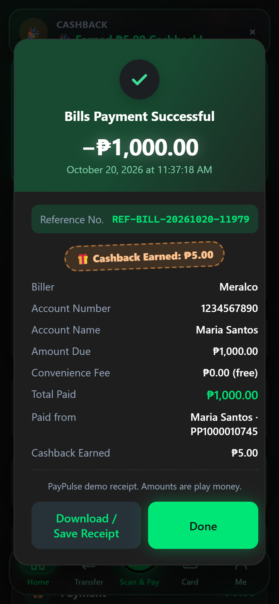
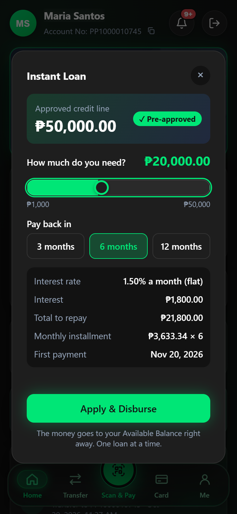
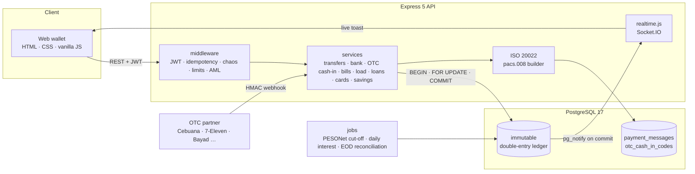
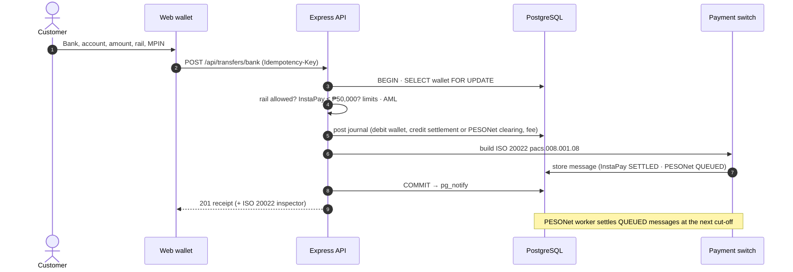
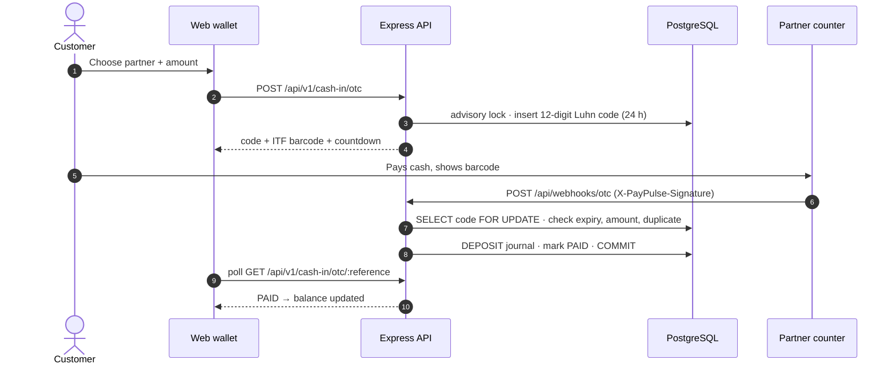
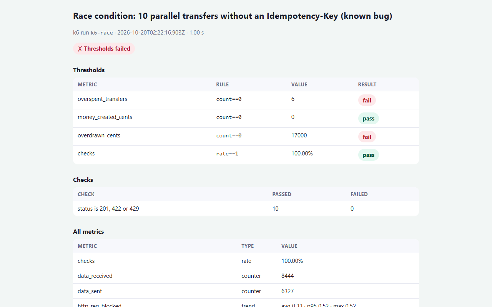
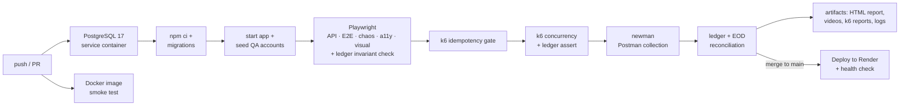
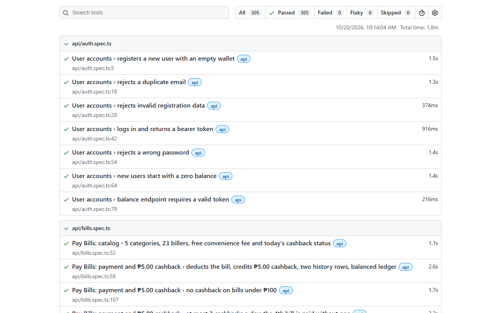

# PayPulse

**A production-style Philippine e-wallet and core-banking engine, built to be tested hard.**

[](https://github.com/brylleopada77/PayPulse/actions/workflows/qa-pipeline.yml)
[](https://github.com/brylleopada77/PayPulse/actions/workflows/deploy-render.yml)
[](https://paypulse-4cqi.onrender.com)
[](https://paypulse-4cqi.onrender.com/api-docs)


| | | | |
|:--:|:--:|:--:|:--:|
|  |  |  |  |
| Home (iOS glass UI) | Pay Bills + ₱5 cashback | Real-time toast (Socket.IO) | Instant Loan |

---

## Contents

1. [Executive summary and tech stack](#1-executive-summary-and-tech-stack)
2. [Core features](#2-core-features)
3. [Setup and installation](#3-setup-and-installation)
4. [Architecture and data flow](#4-architecture-and-data-flow)
5. [Testing strategy](#5-testing-strategy)
6. [The bug the tests were built to catch](#6-the-bug-the-tests-were-built-to-catch)
7. [CI/CD pipeline](#7-cicd-pipeline)
8. [Repository map and further docs](#8-repository-map-and-further-docs)

---

## 1. Executive summary and tech stack

PayPulse is a full-stack **fintech e-wallet and core-banking simulation** inspired by Philippine
digital banks such as Maya and MariBank. It has two goals:

- **A product worth testing.** Send money, bank transfers over InstaPay and PESONet, over-the-counter
  cash-in at 19 partners, Pay Bills, Buy Load, instant loans, a virtual Visa card, a savings vault,
  real-time notifications and an iOS-style glass UI with a dark theme.
- **A backend that can prove it is correct.** An immutable **double-entry general ledger**,
  **ISO 20022** payment messages, compliance rules and end-of-day reconciliation. Every test can check
  not only *what the API answered* but *whether the books still balance*.

It is my senior QA portfolio piece: a **test strategy across six layers (418 Playwright tests)**, a
**real concurrency bug that the automation found, proved and now guards**, and a **CI/CD pipeline**
that runs everything on every push and deploys to production on merge.

> All money is play money. Banks, billers, OTC partners and the card network are mocks.

| Layer | Technology | Used for |
|-------|------------|----------|
| **Frontend** | HTML, CSS, vanilla JavaScript (no framework, no build step) | Mobile-first iOS glass UI, design tokens, generated dark theme, accessible dialogs |
| **Backend** | Node.js 24, Express 5 | REST API with a middleware chain (auth, idempotency, chaos, AML, limits) |
| **Database** | PostgreSQL 17, `pg` driver | Double-entry ledger, `SELECT … FOR UPDATE` row locks, advisory locks, immutability triggers, `LISTEN/NOTIFY` |
| **Payments messaging** | ISO 20022 `pacs.008.001.08` | FI-to-FI credit transfer for every bank transfer, as JSON and XML |
| **Real-time** | Socket.IO 4 | JWT-authenticated, one room per user, events only on commit |
| **Security** | jsonwebtoken, bcryptjs, AES-256-GCM, HMAC-SHA256 | Sessions, MPIN and password hashing, card encryption, signed webhooks |
| **Test automation** | Playwright 1.64 + TypeScript, axe-core, newman | API, browser E2E, chaos, visual regression, accessibility, Postman collection |
| **Load / concurrency** | k6 | Row-lock and idempotency scenarios as hard CI gates |
| **Infrastructure** | Docker Compose, GitHub Actions, Render | Local stack, CI with a PostgreSQL service container, auto-deploy on merge |

> **Why vanilla JS?** The UI is deliberately framework-free, so the test suite targets plain,
> semantic HTML (roles, labels, native radios and `<dialog>`) and nothing is hidden behind a
> component library. The visual style uses hand-written CSS design tokens, not Tailwind.

---

## 2. Core features

### 2.1 Real-time e-wallet and bank transfers (InstaPay and PESONet routing)

| Feature | How it works |
|---------|--------------|
| **Express Send** | Wallet to wallet in real time, MPIN-protected, OTP for transfers above ₱1,000, live "Received ₱…" toast for the recipient |
| **Bank Transfer** | 19 destinations (major banks, digital banks, e-wallets) in a 2-column logo grid, 5 numbered steps, ₱15.00 transaction fee |
| **Rail routing** | A per-destination **routing table** says which rails each institution accepts: every one is on **InstaPay**; **PESONet** (batch) reaches the major banks only. A PESONet transfer to an e-wallet is refused, and the UI marks that option *Not supported* |
| **InstaPay** | Real time, up to **₱50,000** per transfer (`INSTAPAY_LIMIT_EXCEEDED` above it, with a warning in the form). The `pacs.008` is settled at once |
| **PESONet** | No per-transfer cap. Funds move to **GL 2020 PESONet Clearing**, the `pacs.008` is `QUEUED`, and a batch worker settles it at the next cut-off |
| **ISO 20022 inspector** | `GET /api/v1/transactions/:id/iso20022` returns the message. The receipt's *ISO 20022 Message Inspector* tab shows highlighted XML with *Copy Payload* |
| **Real-time notifications** | PostgreSQL `LISTEN/NOTIFY` → Socket.IO. Events are sent only after commit, so a rolled-back payment never announces itself |

### 2.2 OTC cash-in and remittance partners

Cash in over the counter at **19 partners in 4 categories**:

| Category | Partners |
|----------|----------|
| Pawnshops and remittance | Cebuana Lhuillier, M Lhuillier, Palawan Express, Bayad Center, RD Pawnshop, Villarica, Tambunting |
| Stores | 7-Eleven (CLiQQ), Uncle John's, Alfamart, Pay&Go / TouchPay |
| Malls | SM Bills Payment, Robinsons Dept. Store, Puregold, Waltermart |
| Pharmacies | Mercury Drug, Watsons, Generika, Southstar Drug |

**The payment-code engine:**

1. The customer picks a partner and an amount (₱100 to ₱50,000). The fee follows the partner's rule: free, ₱15 flat or 1%.
2. PayPulse issues a **12-digit reference with a Luhn check digit** (`1234-5678-9012`), valid for **24 hours**, with at most 5 pending codes per user (advisory-locked).
3. The ticket shows the code as an **ITF (Interleaved 2 of 5) barcode** rendered in SVG, plus a live countdown.
4. The partner confirms payment with an **HMAC-signed webhook** (`POST /api/webhooks/otc`, `X-PayPulse-Signature`).
5. The confirmation locks the code row (`FOR UPDATE`), then checks it:
   - a replayed confirmation returns `duplicate: true` and no money moves;
   - an expired code returns `410 CODE_EXPIRED`;
   - a wrong amount returns `409 AMOUNT_MISMATCH`.
6. If it passes, the deposit is posted to the ledger. The open ticket polls and flips to *Paid*.

> PayPulse supports **inbound** cash-in at remittance and pawnshop counters. It does not send outbound remittances.

### 2.3 Enterprise banking engine

| Safeguard | How it works |
|-----------|--------------|
| **Double-entry general ledger** | Balances are never stored. They are `SUM(credits − debits)` over an append-only ledger with a chart of accounts (GL 1010 Cash … 5020 Cashback Expense). Every journal must balance before it is written, and triggers block `UPDATE` and `DELETE`. |
| **Row-level locking** | Every payment out of a wallet runs in one transaction. It locks the wallet with `SELECT … FOR UPDATE`, re-reads the balance, re-runs limit and AML checks on the same connection, then posts the journal. Savings moves lock both accounts in id order, so they cannot deadlock. Top-ups and OTC codes use `pg_advisory_xact_lock` per user. |
| **Idempotency** | An `Idempotency-Key` stores the first answer, and retries get it back (`Idempotent-Replayed: true`). A concurrent duplicate gets `409 IDEMPOTENCY_IN_PROGRESS`. |
| **Compliance** | Daily limit of ₱50,000 (KYC Level 1) or ₱100,000 (Level 2). Anti-spam: at most 3 transfers in 10 s (`429`). AML holds for transfers above ₱500,000 or more than 5 in a minute. |
| **Authentication** | 6-digit MPIN, bcrypt-hashed, locked after 5 wrong tries. 30-second single-use OTP bound to the recipient and amount. JWT sessions revoked by a password reset. |
| **End-of-day reconciliation** | 20 control checks of GL accounts against their sub-ledgers (wallets, savings, loans, settlement, PESONet clearing, OTC cash-in, ISO 20022 status), written to an audit log |

Also on the same ledger:

- **Pay Bills:** 23 billers with ₱5 cashback.
- **Buy Load:** 6 telcos and 21 promos, with the network detected from the number prefix.
- **Instant Loans:** a ₱50,000 line.
- **Virtual Visa:** the card number is AES-256-GCM encrypted and the CVV is never stored.
- **PayPulse Save:** 6% p.a. with daily interest.

### 2.4 QA engineering and resilience

| Capability | What it proves |
|------------|----------------|
| **Playwright E2E** | Real customer journeys in Chrome: OTC cash-in with barcode and webhook, bank transfer with rail rules, Pay Bills net ₱995.00, loan drawdown, locked card `403 CARD_FROZEN`, Buy Load telco shortcuts |
| **Chaos fault injection** | `x-chaos-*` headers and a QA-panel **Chaos Engine**: 503 drops before or after the server acts, 2 s DB row locks, 3 s latency, and random 20% HTTP 500s. The UI retries with the same Idempotency-Key, and **money moves exactly once**. |
| **Automated ledger invariant checks** | [`scripts/assert-ledger.js`](scripts/assert-ledger.js) runs after **every** Playwright run (`globalTeardown`) and after k6: debits = credits, all balances sum to zero, the trial balance holds, no wallet is overdrawn, and total system cash = user balances + fees + reserves |
| **Concurrency gates** | 10 identical ₱60 transfers from a ₱100 wallet: **exactly 1** succeeds. 30 duplicate sends with one key: **1** transfer. |
| **Accessibility** | axe-core WCAG 2.2 AA on every screen and dialog, in light and dark, plus keyboard focus-trap checks |
| **Contract** | Every Express route is in the OpenAPI 3 document and vice versa. The Postman collection (72 requests) is generated from it and run with newman. |

Chaos and sandbox tools are **admin-only** and exist only when the server runs with `QA_SANDBOX=true`.

---

## 3. Setup and installation

**Requirements:** Node.js 20+ (24 recommended), PostgreSQL (17 is used in CI) and Google Chrome (the browser tests use
the installed Chrome). Docker is optional.

### Option A: Node + local PostgreSQL

```bash
git clone https://github.com/brylleopada77/PayPulse.git
cd PayPulse

npm install                 # install dependencies
cp .env.example .env        # then set DATABASE_URL to your PostgreSQL database
npm run db:init             # apply db/schema.sql (re-runnable migration)
npm run dev                 # start the API + web app with auto-reload on http://localhost:3000
```

Open **http://localhost:3000** and create an account. Your MPIN is shown once. To use *Add money* and
the QA Sandbox, make yourself an admin:

```bash
npm run admin:set -- you@example.com ADMIN
```

### Option B: Docker

```bash
docker compose up --build   # app + PostgreSQL 17; the schema is applied automatically
docker compose exec app node scripts/set-role.js you@example.com ADMIN
```

### Running the tests

With the app running in another terminal:

```bash
npm run test:e2e            # browser E2E + chaos/resilience in Chrome (Playwright "ui" project)
npm run test:api            # all 418 Playwright tests: api, ui, a11y, visual (+ ledger check at the end)
npx playwright test --project=a11y    # axe-core WCAG 2.2 AA scans only
npm run test:report         # open the HTML report

npm run test:concurrency    # k6 row-lock scenario + ledger assertion (requires k6)
npm run postman:test        # Postman collection with newman
npm run eod:reconcile       # end-of-day reconciliation (20 control checks)
```

Visual baselines are per OS. After an intended UI change, run
`npx playwright test --project=visual --update-snapshots`.

| Script | Purpose |
|--------|---------|
| `npm run dev` / `npm start` | Start the server (with or without file watching) |
| `npm run db:init` / `npm run db:seed` | Apply the schema / seed QA accounts |
| `npm run db:assert-ledger` | Ledger invariant check on demand |
| `npm run pesonet:worker` | Settle queued PESONet batches |
| `npm run theme:dark` | Regenerate `public/theme-dark.css` from `styles.css` (CI fails if stale) |
| `npm run postman:build` | Regenerate the Postman collection from the OpenAPI document |

---

## 4. Architecture and data flow

### System architecture



### Data flow: a bank transfer



### Data flow: OTC cash-in



---

## 5. Testing strategy

| Layer | Tool | Count | Risk it covers |
|-------|------|------:|----------------|
| API | Playwright `request` | 347 | Business rules, validation, error contracts (`{ error: { code, message, details } }`), security (MPIN/OTP lockouts, PCI masking, access to other users' data), money math in centavos |
| Browser E2E + chaos | Playwright + Chrome | 33 | Customer journeys, plus 503 drops, DB locks and retries with no duplicated or lost money |
| Visual regression | `toHaveScreenshot` | 19 | The glass dock and Home layout on 5 viewports, plus the dark theme |
| Accessibility | `@axe-core/playwright` | 19 | WCAG 2.2 AA on 12 screens in light and dark; keyboard-only flows |
| API contract (part of the 347) | OpenAPI 3 + Playwright | 4 | Every route documented, every documented operation exists |
| Postman | newman | 72 requests | Every endpoint chained end to end, ~100 assertions |
| Load / concurrency | k6 | 2 | Row locking and idempotency as hard gates |
| Accounting | Node + SQL | 3 | Ledger integrity, system ledger, EOD reconciliation |

**Design choices that keep the suite trustworthy**

- **Isolation.** Every test creates its own users, so all 418 run `fullyParallel` with no shared state.
  Locally there are 0 retries. CI allows one retry only to capture a video, and a test that needs it is reported **flaky** and gets fixed.
- **Assert the money, not just the status.** Money-moving tests check balances *and* ledger entries.
- **Deterministic time.** A guarded `paypulse.allow_time_travel` setting lets tests age transactions without sleeping.
- **Stable error codes.** Tests assert on `code`, not on wording.

---

## 6. The bug the tests were built to catch

`POST /api/transfers` used to read the sender's balance **without a lock**, then check and write. That
is a check-then-act race, shipped on purpose as a target for the automation.

| Evidence | Before the fix | After (row-level locking) |
|----------|----------------|---------------------------|
| k6: 10 parallel ₱30 transfers from ₱100 | **10 succeeded**, wallet at **−₱200** (the ledger still could not create money) | 3 succeed, wallet at ₱10.00 |
| k6: 10 identical ₱60 transfers from ₱100 | several succeeded | **exactly 1** succeeds, 9 × `422 INSUFFICIENT_FUNDS` |
| Burst past anti-spam (3 per 10 s) | every request read "0 so far" | 3 pass, 7 × `429` |
| End-of-day reconciliation | `OD-1` flagged overdrawn wallets | `OD-1` clean |



**The fix:** [`src/services/walletLock.js`](src/services/walletLock.js). The concurrency tests, the k6 gate and the
overdraft check are now hard gates in CI. Root cause, reproduction, fix and data remediation are in
**[QA_NOTES.md](QA_NOTES.md)**.

---

## 7. CI/CD pipeline



Every run publishes the Playwright HTML report (screenshots of every failure, videos of retried
tests), traces and JUnit XML, the k6 reports, the EOD audit log and the app log.



---

## 8. Repository map and further docs

```
src/            Express API: routes, services (ledger, transfers, OTC, ISO 20022, bills, loans, cards…), realtime.js
public/         web wallet (vanilla JS, iOS glass design, generated dark theme)
db/schema.sql   schema, chart of accounts, immutability + notify triggers (re-runnable migration)
tests/api/      347 API tests (25 suites)              tests/e2e/      customer journeys in Chrome
tests/a11y/     axe-core accessibility + keyboard       tests/visual/   visual regression + baselines
tests/load/     k6 concurrency + idempotency            tests/resilience.spec.ts  chaos tests
scripts/        ledger assertion, EOD reconciliation, PESONet worker, generators
postman/        generated collection + local/live environments
```

- **[QA_NOTES.md](QA_NOTES.md):** the race condition, from root cause to remediation.
- **[docs/TECHNICAL_REFERENCE.md](docs/TECHNICAL_REFERENCE.md):** full API reference, business rules, error codes and chart of accounts.
- **Interactive API docs:** [`/api-docs`](https://paypulse-4cqi.onrender.com/api-docs). Swagger UI lets you authorize with your JWT and *Try it out*.
- **Postman:** import [`postman/PayPulse.postman_collection.json`](postman/PayPulse.postman_collection.json)
  with the [local](postman/PayPulse-local.postman_environment.json) or [live](postman/PayPulse-live.postman_environment.json) environment, then run **0. Setup**.

---

*Built by **Brylle Opada** as a QA automation and fintech engineering portfolio project. All balances are
play money; banks, billers, OTC partners and the card network are mocks.*
