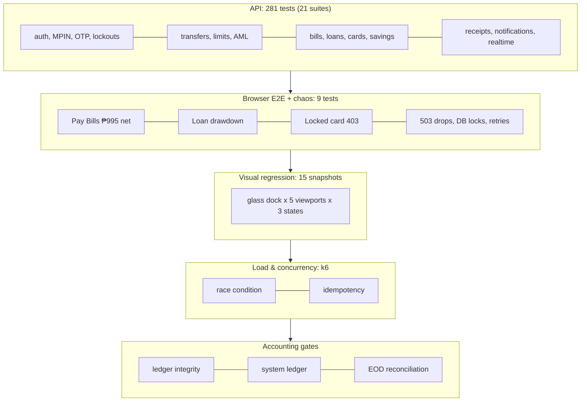
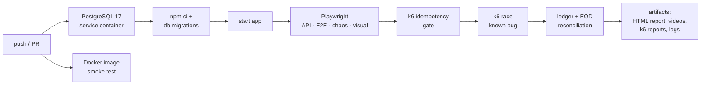
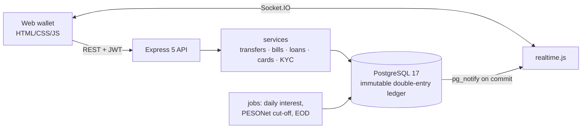

# PayPulse: a QA automation showcase built around a realistic e-wallet

[](https://github.com/brylleopada77/PayPulse/actions/workflows/playwright.yml)


PayPulse is a Philippine-style mobile e-wallet (send money, pay bills, instant loans, virtual Visa,
savings) with a **double-entry general ledger** underneath. I built it to practise and demonstrate
senior QA work end to end: a product worth testing, a **test strategy across five layers**, an
**intentional concurrency bug** that the automation finds and proves, and a **CI pipeline** that
runs everything on every push.

> **305 Playwright tests · 2 k6 scenarios · 3 ledger/reconciliation gates · all green in CI**
> (the known race bug is reported, not hidden: see [the race condition](#the-bug-the-tests-were-built-to-catch)).

| | | | |
|:--:|:--:|:--:|:--:|
|  |  |  |  |
| Home (iOS glass UI) | Pay Bills + ₱5 cashback | Real-time toast (Socket.IO) | Instant Loan |

---

## What this project demonstrates

| Area | What I did | Where |
|------|------------|-------|
| **Test strategy** | API, browser E2E, chaos/resilience, visual regression, load/concurrency and accounting checks, each answering a different risk | [Testing strategy](#testing-strategy) |
| **Finding a real bug** | Concurrency tests and k6 reproduce an overdraft race; the evidence is in the k6 report (wallet driven to **-₱200**) | [QA_NOTES.md](QA_NOTES.md) |
| **Proving a fix pattern** | k6 shows `Idempotency-Key` makes 30 duplicate sends move money **exactly once** | `tests/load/idempotent-transfer.js` |
| **Financial correctness** | Every test can assert the ledger: debits = credits, wallets = GL 2010, end-of-day reconciliation with 20 control checks | `tests/helpers/db.ts`, `scripts/reconcile-eod.js` |
| **Test design** | Every test creates its own users, so 305 tests run **fully in parallel** without shared state or ordering | `tests/helpers/api.ts` |
| **Tuning, not just writing tests** | Visual regression first missed a 28px→8px dock change; I tightened the threshold and proved it now fails on the regression and stays stable over repeated runs | `playwright.config.ts` |
| **CI/CD** | GitHub Actions: PostgreSQL service container, migrations, Playwright, k6, ledger gates, HTML report + videos as artifacts | [CI pipeline](#ci-pipeline) |

---

## Testing strategy



| Layer | Tool | Count | Risk it covers |
|-------|------|------:|----------------|
| API | Playwright `request` | 281 | Business rules, validation, error contracts (`{ error: { code, message, details } }`), security (MPIN/OTP lockouts, PCI masking, other users' data), money math in centavos |
| Browser E2E | Playwright + Chrome | 4 | Real customer journeys: Pay Bills (net **₱995.00** after ₱5 cashback), ₱10,000 loan drawdown, locked virtual card → **403 CARD_FROZEN**, live toast on incoming money |
| Chaos / resilience | Playwright + `x-chaos-*` headers | 5 | 503 drops before/after the server acts, exhausted retries, 2-second DB locks: the UI retries safely and **no money is duplicated or lost** |
| Visual regression | `toHaveScreenshot` | 15 | The glassmorphic iOS dock and Home layout on iPhone SE, iPhone 15, Pixel 7, iPad mini and desktop |
| Load / concurrency | k6 1.3 | 2 | The overdraft race (expected to fail until fixed) and the idempotency guarantee (must pass) |
| Accounting | Node + SQL | 3 | Debits = credits, money in system = balances + fees, GL control accounts vs. sub-ledgers at end of day |

**Design choices that keep the suite trustworthy**

- **Isolation:** tests never share users or rely on order; `fullyParallel: true`, `retries: 0` (a flaky test gets fixed, not retried).
- **Assert the money, not just the status:** most money-moving tests check balances *and* the ledger.
- **Deterministic time:** a guarded `paypulse.allow_time_travel` session setting lets tests age transactions (anti-spam windows, "yesterday") without sleeping.
- **Contract-level errors:** every error has a stable `code`, so tests assert on meaning, not wording.
- **Real-time safety:** live notifications come from PostgreSQL `LISTEN/NOTIFY`, delivered only on commit. A test proves a refused payment announces nothing.

---

## The bug the tests were built to catch

`POST /api/transfers` reads the sender's balance **without a lock**, then checks and writes: a
classic check-then-act race. It is left in on purpose as a target for the automation.

| Evidence | Result |
|----------|--------|
| k6: 10 parallel ₱30 transfers from a ₱100 wallet | **10 succeeded**, wallet at **-₱200**, 7 transfers over the limit; total money unchanged (the ledger can't create money) |
| k6: the same transfer 30× with one `Idempotency-Key` | **exactly 1 transfer**, 28 replays, 1 `409 IN_PROGRESS`, 0 errors |
| End-of-day reconciliation | `OD-1` flags the overdrawn wallets; every GL control still balances |


Root cause, reproduction steps and the fix (`SELECT … FOR UPDATE`, already used by Pay Bills, cards
and savings) are written up in **[QA_NOTES.md](QA_NOTES.md)**. In CI the race checks are reported but
non-blocking while `RACE_BUG_EXPECTED=true`; flipping it to `false` turns them into hard gates.

---

## CI pipeline

[`.github/workflows/playwright.yml`](.github/workflows/playwright.yml) runs on every push and pull request.



**Artifacts on every run:** `playwright-report` (HTML report with screenshots and a video of every
browser test), `test-results` (videos, traces, JUnit XML), `k6-and-logs` (k6 HTML/JSON reports, EOD
audit log, app log). A summary table is posted to the run page.


---

## Product features under test

- **Money movement:** Express Send (with an OTP above ₱1,000), Bank Transfer over InstaPay and PESONet (ISO 20022 pacs.008), QR Ph, receipts.
- **Pay Bills:** 23 Philippine billers, ₱5 cashback on bills of ₱100 or more (max 3 a day), double-entry posting.
- **Instant Loan:** ₱50,000 credit line, 3/6/12 months, interest-first repayments.
- **Virtual Visa:** AES-256-GCM tokenized PAN, CVV never stored, lock/unlock, online purchases.
- **PayPulse Save:** 6% p.a. with a daily interest job.
- **Profile:** KYC levels (₱50k → ₱100k daily limit), linked accounts, Change MPIN, SMS 2FA.
- **Notifications:** updates, events, activity, plus real-time Socket.IO toasts.
- **Controls:** daily limit, anti-spam, AML holds, admin-only top-ups, QA sandbox and chaos headers.

   

---

## Architecture



Balances are never stored: they are computed from an append-only ledger (`UPDATE`/`DELETE` are blocked by triggers),
mapped to a chart of accounts (GL 1010 cash … 5020 cashback expense).

**Stack:** Node.js 24 · Express 5 · PostgreSQL 17 · Socket.IO 4 · Playwright 1.64 · k6 1.3 · Docker Compose · GitHub Actions.

---

## Run it

**With Docker** (app + database):

```bash
docker compose up -d --build --wait     # http://localhost:3000
```

**Run the tests** (against the running app):

```bash
npm ci
npx playwright install ffmpeg            # for test videos (tests use your installed Chrome)
npx playwright test                       # all 305: projects api, ui, visual
npx playwright test --project=ui          # E2E + chaos in a real browser
npx playwright show-report                # open the HTML report

docker compose run --rm k6                                         # k6 race condition (known bug)
docker compose run --rm k6 run /scripts/idempotent-transfer.js     # k6 idempotency
npm run db:check && node tests/assert-system-ledger.js && npm run eod:reconcile
```

Without Docker, use a local PostgreSQL, `npm run db:init` and `npm start` (see the reference docs).
Visual baselines are per OS; after an intended UI change run `npx playwright test --project=visual --update-snapshots`.

---

## Repository map

```
src/            Express API: routes, services (ledger, transfers, bills, loans, cards, KYC…), realtime.js
public/         web wallet (vanilla JS, iOS glass design)
db/schema.sql   schema, chart of accounts, immutability + notify triggers (re-runnable migration)
tests/api/      281 API tests (21 suites)            tests/e2e/      customer journeys in Chrome
tests/visual/   visual regression + baselines         tests/load/     k6: race + idempotency (+ HTML reports)
tests/resilience.spec.ts  chaos tests                 scripts/        EOD reconciliation, workers
```

## More documentation

- **[QA_NOTES.md](QA_NOTES.md):** the race condition: root cause, reproduction, fix.
- **[docs/TECHNICAL_REFERENCE.md](docs/TECHNICAL_REFERENCE.md):** full API reference, business rules, error codes, chart of accounts, every feature in detail.

---

*Built by **Brylle Opada** as a QA automation portfolio project. All balances are play money; billers, banks and card network are mocks.*
