# PayPulse: a QA automation showcase built around a realistic e-wallet

[](https://github.com/brylleopada77/PayPulse/actions/workflows/qa-pipeline.yml)


PayPulse is a **production-style fintech e-wallet and core-banking simulation** with a dual purpose:

1. **A modern e-wallet experience**, inspired by Philippine digital banks such as MariBank and Maya:
   send money, pay bills, instant loans, a virtual Visa, savings, an iOS-style glass UI with a floating
   dock, dark mode and real-time notifications.
2. **A core-banking backend built to be tested hard**: an immutable **double-entry general ledger**,
   ISO 20022 payment messages, compliance rules and end-of-day reconciliation, so every test can check
   not only *what the API said* but *whether the books still balance*.

I built it to demonstrate senior QA work end to end: a product worth testing, a **test strategy
across five layers**, an **intentional concurrency bug** that the automation finds and proves, and a
**CI pipeline** that runs everything on every push. (All money is play money; banks, billers and the
card network are mocks.)

> **374 Playwright tests · 2 k6 scenarios · 3 ledger/reconciliation gates · all green in CI**
> (the known race bug is reported, not hidden: see [the race condition](#the-bug-the-tests-were-built-to-catch)).

| | | | |
|:--:|:--:|:--:|:--:|
| 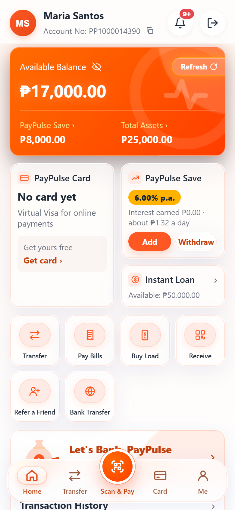 | 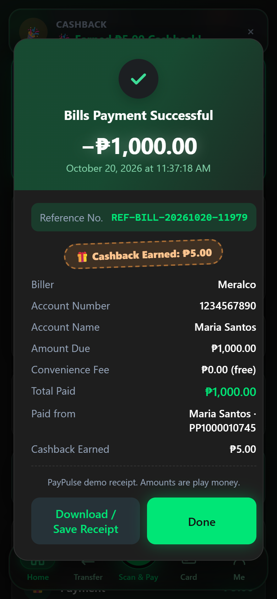 | 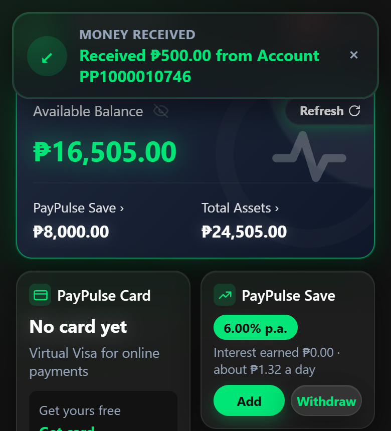 | 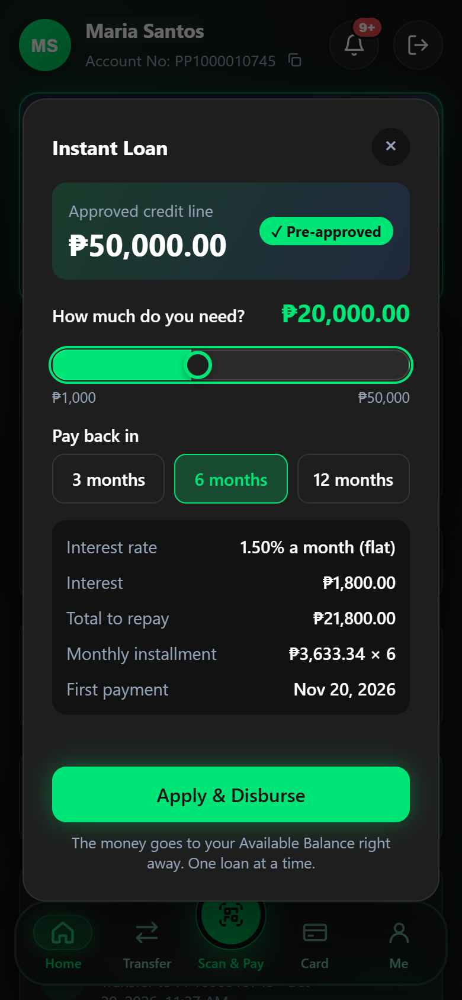 |
| Home (iOS glass UI) | Pay Bills + ₱5 cashback | Real-time toast (Socket.IO) | Instant Loan |

---

## What this project demonstrates

| Area | What I did | Where |
|------|------------|-------|
| **Test strategy** | API, browser E2E, chaos/resilience, visual regression, load/concurrency and accounting checks, each answering a different risk | [Testing strategy](#testing-strategy) |
| **Finding a real bug** | Concurrency tests and k6 reproduce an overdraft race; the evidence is in the k6 report (wallet driven to **-₱200**) | [QA_NOTES.md](QA_NOTES.md) |
| **Proving a fix pattern** | k6 shows `Idempotency-Key` makes 30 duplicate sends move money **exactly once** | `tests/load/idempotent-transfer.js` |
| **Financial correctness** | Every test can assert the ledger: debits = credits, wallets = GL 2010, end-of-day reconciliation with 20 control checks | `tests/helpers/db.ts`, `scripts/reconcile-eod.js` |
| **Test design** | Every test creates its own users, so 374 tests run **fully in parallel** without shared state or ordering | `tests/helpers/api.ts` |
| **Tuning, not just writing tests** | Visual regression first missed a 28px→8px dock change; I tightened the threshold and proved it now fails on the regression and stays stable over repeated runs | `playwright.config.ts` |
| **CI/CD** | GitHub Actions: PostgreSQL service container, migrations, Playwright, k6, ledger gates, HTML report + videos as artifacts | [CI pipeline](#ci-pipeline) |

---

## Testing strategy

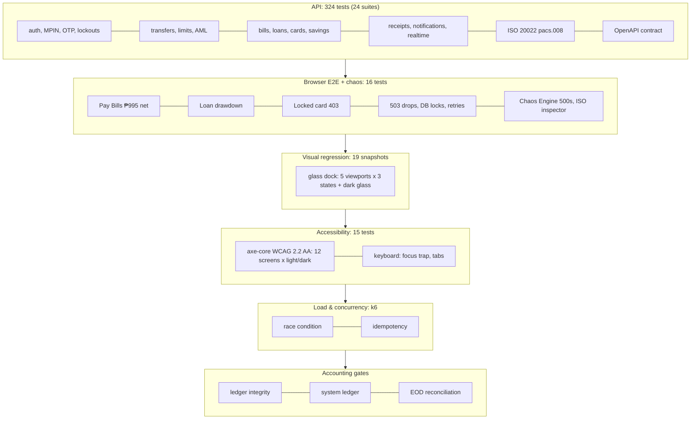

| Layer | Tool | Count | Risk it covers |
|-------|------|------:|----------------|
| API | Playwright `request` | 324 | Business rules, validation, error contracts (`{ error: { code, message, details } }`), security (MPIN/OTP lockouts, PCI masking, other users' data), money math in centavos |
| Browser E2E | Playwright + Chrome | 11 | Real customer journeys: Pay Bills (net **₱995.00** after ₱5 cashback), ₱10,000 loan drawdown, locked virtual card → **403 CARD_FROZEN**, live toast on incoming money, Buy Load, the Chaos Engine fault toast and recovery, the ISO 20022 Message Inspector (XML + Copy Payload) |
| Chaos / resilience | Playwright + `x-chaos-*` headers | 5 | 503 drops before/after the server acts, exhausted retries, 2-second DB locks: the UI retries safely and **no money is duplicated or lost** |
| Visual regression | `toHaveScreenshot` | 19 | The glassmorphic iOS dock and Home layout on iPhone SE, iPhone 15, Pixel 7, iPad mini and desktop, plus the dark glass theme |
| Accessibility | `@axe-core/playwright` | 15 | WCAG 2.0 / 2.1 / 2.2 A + AA on login, Home, Send, Pay Bills, Buy Load, receipt + ISO inspector, notifications, profile, logout and the QA panel, in **light and dark**; keyboard-only login, dialog focus trap / focus return, ARIA tabs |
| API contract | OpenAPI 3 + Playwright | 4 | Every Express route is documented at `/api-docs` and every documented operation exists; `$ref`s resolve; documented GETs answer with a documented status |
| Postman collection | Postman / newman | 72 requests | Every endpoint chained end to end (register → fund → send, OTP, idempotent replay, bank, bills, load, savings, loan, cards, QR, profile, negative cases); ~100 assertions; generated from the OpenAPI document |
| Load / concurrency | k6 1.3 | 2 | The overdraft race (expected to fail until fixed) and the idempotency guarantee (must pass) |
| Accounting | Node + SQL | 3 | Debits = credits, total system cash = balances + fees + reserves (also run automatically after every Playwright run), GL control accounts vs. sub-ledgers at end of day |

**Design choices that keep the suite trustworthy**

- **Isolation:** tests never share users or rely on order; `fullyParallel: true`; locally `retries: 0`, on CI one retry only to record a video, and a test that needs it is reported as **flaky** (it gets fixed, not hidden). Screenshots on failure, videos on the first retry.
- **Assert the money, not just the status:** most money-moving tests check balances *and* the ledger.
- **Deterministic time:** a guarded `paypulse.allow_time_travel` session setting lets tests age transactions (anti-spam windows, "yesterday") without sleeping.
- **Contract-level errors:** every error has a stable `code`, so tests assert on meaning, not wording.
- **Real-time safety:** live notifications come from PostgreSQL `LISTEN/NOTIFY`, delivered only on commit. A test proves a refused payment announces nothing.

---

## The bug the tests were built to catch

`POST /api/transfers` reads the sender's balance **without a lock**, then checks and writes: a
classic check-then-act race. It is left in on purpose as a target for the automation.

| Evidence | Result |
|----------|--------|
| k6: 10 parallel ₱30 transfers from a ₱100 wallet | **10 succeeded**, wallet at **-₱200**, 7 transfers over the limit; total money unchanged (the ledger can't create money) |
| k6: the same transfer 30× with one `Idempotency-Key` | **exactly 1 transfer**, 28 replays, 1 `409 IN_PROGRESS`, 0 errors |
| End-of-day reconciliation | `OD-1` flags the overdrawn wallets; every GL control still balances |

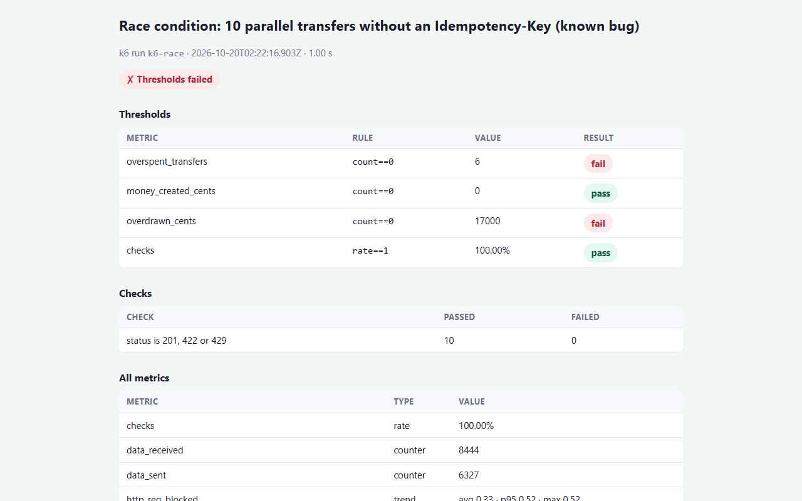

Root cause, reproduction steps and the fix (`SELECT … FOR UPDATE`, already used by Pay Bills, cards
and savings) are written up in **[QA_NOTES.md](QA_NOTES.md)**. In CI the race checks are reported but
non-blocking while `RACE_BUG_EXPECTED=true`; flipping it to `false` turns them into hard gates.

### Accessibility: what axe found and how it was fixed

The first axe-core run found **real WCAG 2.2 AA violations**, all fixed in the same change and now guarded by `tests/a11y`:

| Finding | Fix |
|---------|-----|
| Muted captions `#64748b` on the blue tints: 4.23:1 | `--muted: #576579` (5.27:1) |
| White on the dark-mode accent `#3d7bff`: 3.84:1 | dark `--accent: #2b66f6` (4.85:1) |
| White on the red unread badges `#e5484d`: 3.91:1 | `#cd2b31` (5.27:1) |
| Green "free" / success text `#0e9f6e`: 3.01:1 | `--success: #047857` (4.88:1) |
| QA panel unreadable in dark mode (1.62:1) | the dark theme generator leaves the always-dark dev panel alone |
| History rows: `<li role="button">` inside `<ul>` | a real `<button>` inside each `<li>` |
| Accessible names not matching visible text (profile, bell "9+", Instant Loan) | names include the visible text |
| Radio inputs inside `role="tablist"` (Buy Load) | `role="radiogroup"` |

---

## Senior QA engineering highlights

### 1. Concurrency and double-spend protection

Three independent safeguards, each proven by tests:

| Safeguard | How it works | Proven by |
|-----------|--------------|-----------|
| **The ledger can't create money** | Balances are never stored; they are `SUM(credits − debits)` over an append-only ledger. Every journal must balance before it is written, and triggers block `UPDATE`/`DELETE`. A race can at worst *overdraw* a wallet, never mint money. | `money_created_cents == 0` in k6, ledger checks |
| **Row-level locks** | Money-moving services lock before they check: `SELECT … FOR UPDATE` on the wallet (Pay Bills), card + wallet (card payments), both accounts in id order (savings, so two moves can't deadlock), the user row + a partial unique index (one open loan), and `pg_advisory_xact_lock` per user (top-ups). Done with the `pg` driver inside one transaction. | parallel-request tests: e.g. 5 × ₱300 bills from ₱1,000 → never below ₱0 |
| **Idempotency keys** | `Idempotency-Key` stores the first answer; retries get it back (`Idempotent-Replayed: true`), a concurrent duplicate gets `409 IDEMPOTENCY_IN_PROGRESS`. | k6: 30 sends, **1** transfer |

The one deliberate gap is `POST /api/transfers`, which skips the lock so the automation has a real
bug to catch ([above](#the-bug-the-tests-were-built-to-catch)).

### 2. Chaos engineering and resilience

| Fault | How it is injected | What the tests assert |
|-------|--------------------|-----------------------|
| **3-second network latency** | QA Sandbox switch "Simulate 3s Network Latency": every authenticated API call of that user waits 3 s (`requireAuth`) | every call takes at least 3 s and still succeeds; the QA controls themselves stay fast |
| **Forced HTTP 500** | QA Sandbox "Trigger HTTP 500 Error": the next money-moving request fails with `500 INTERNAL_ERROR` (`details.simulated: true`) | a clean `500`, nothing debited or recorded, and the switch turns itself off (transfers, top-ups, bills, loans) |
| **Dropped responses (503)** | `x-chaos-mode` headers: drop **before** the server acts, or **after** it acted (the answer is lost) | the UI retries with the same Idempotency-Key, shows "Retrying (n/3)…", and the money moves **exactly once** |
| **Database lock contention** | `x-chaos-fault: db-lock` holds a real row lock on the wallet for 2 s | the UI shows it is waiting and completes correctly |
| **Random HTTP 500 fault injection** | **Chaos Engine** switch in the QA panel (`x-chaos-fault: error-500`, rate 20%): transfers, bank transfers, top-ups, bills and load fail with `500 CHAOS_FAULT_INJECTED` **before** they run; other requests are untouched | a glass "⚠️ Chaos Engine: Server Fault Injected. Retrying transaction…" toast, automatic retries with the same Idempotency-Key, "recovered", and the transfer in the ledger **exactly once** |
| **Header latency** | `x-chaos-latency-ms: N` (max 10 s) on any request | the request is delayed by N ms and still succeeds |

Chaos and sandbox tools are **admin-only** and exist only when the server runs with `QA_SANDBOX=true`.

### 3. Automated ledger assertion

[`scripts/assert-ledger.js`](scripts/assert-ledger.js) runs **automatically at the end of every
Playwright run** (`globalTeardown`, [`tests/global-teardown.ts`](tests/global-teardown.ts)) and again in CI
after k6. It proves that money is **conserved** across the whole system:

$$
\underbrace{\text{top-ups} - \text{bank payouts} + \text{QA adjustments} + \text{interest} + \text{loans (net)} - \text{bill \& card spend (net of cashback)}}_{\text{Total System Cash}}
= \sum \text{User Balances} + \text{Collected Fees} + \text{Reserves (PESONet pending)}
$$

It also asserts `SUM(debit) - SUM(credit) = 0` over every ledger entry, that **all balances (users +
system accounts) sum to zero**, the **trial balance** holds, **every transaction balances**, and **no
customer wallet is overdrawn**. Any accounting failure fails the run; wallets overdrawn by the known race
bug are reported as `KNOWN` while `RACE_BUG_EXPECTED=true`. The end-of-day job ([`scripts/reconcile-eod.js`](scripts/reconcile-eod.js)) goes further
with 20 checks of each GL control account against its sub-ledger (wallets, savings, loans, biller and
card settlement, fees, PESONet clearing, ISO 20022 message status) and writes an audit log.

---

## CI pipeline

[`.github/workflows/qa-pipeline.yml`](.github/workflows/qa-pipeline.yml) runs on every push and pull request.

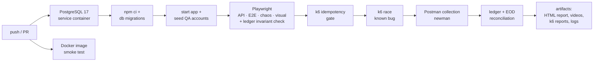

**Artifacts on every run:** `playwright-report` (HTML report; a screenshot of every failure and a
video of every retried test), `test-results` (videos, traces, JUnit XML), `k6-and-logs` (k6 HTML/JSON reports, EOD
audit log, app log). A summary table is posted to the run page.

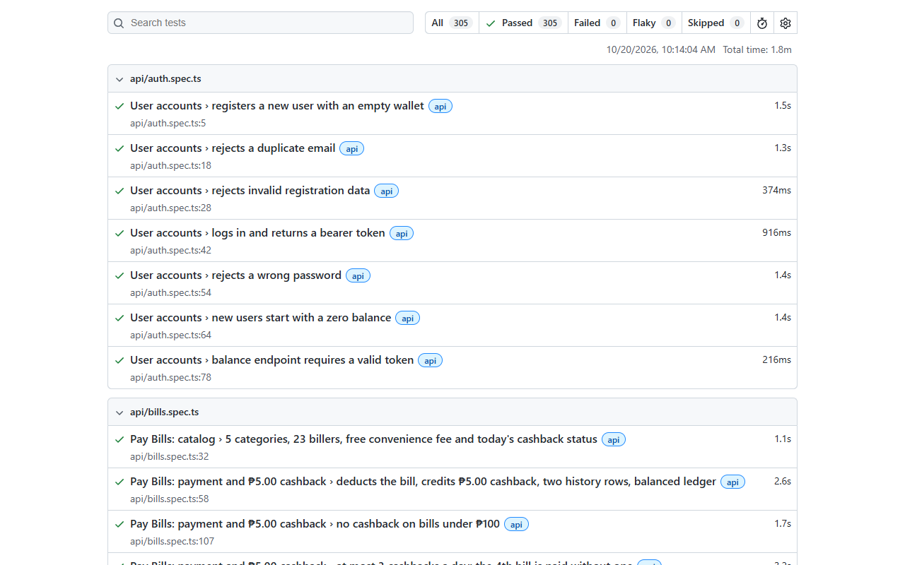

---

## Key features

### Financial engine

| Feature | Details |
|---------|---------|
| **Double-entry general ledger** | Immutable journals, balances computed from entries, chart of accounts (GL 1010 cash … 5020 cashback expense), trial balance view |
| **ISO 20022 messaging** | Every bank transfer produces a `pacs.008.001.08` FI-to-FI credit transfer; InstaPay settles instantly, PESONet in batches at the cut-off. `GET /api/v1/transactions/:id/iso20022` serialises any transfer, bill payment or load purchase from its ledger entries, shown in the receipt's **ISO 20022 Message Inspector** tab (highlighted XML, Copy Payload) |
| **Instant Loans** | ₱50,000 pre-approved line, 3 / 6 / 12 months at 1.5% a month flat, MPIN to apply, interest-first repayments, GL 1030 / 4020 |
| **Virtual Visa cards** | AES-256-GCM encrypted PAN, CVV derived and never stored, PCI-style masking, lock / unlock, online purchases (locked card → `403 CARD_FROZEN`) |
| **Buy Load** | Prepaid top-up for Globe, TM, Smart, TNT, DITO and GOMO: network detected from the number prefix (brand chosen within Globe/TM and Smart/TNT, override for ported numbers), regular load ₱10–₱1,000 or promo packages, **₱5.00 cashback** on loads of ₱50 or more (max 3 a day), GL 2060 Telco Settlement |
| **Pay Bills + cashback engine** | 23 Philippine billers in 5 categories; an automated **₱5.00 cashback** on bills of ₱100 or more (max 3 a day), posted as its own journal |
| **PayPulse Save** | 6.00% p.a. savings vault with a daily interest job and fractional-centavo carry-over; every day's interest in the history |

### Security and compliance

| Control | Rule |
|---------|------|
| **MPIN** | Random 6-digit MPIN per user (bcrypt-hashed), valid 5 minutes; 5 wrong in a row lock transfers for 5 minutes; weak PINs (111111, 123456) rejected on change |
| **2FA OTP** | One-time code for transfers above ₱1,000 (every transfer with SMS 2FA on): 30-second validity, 3 tries, single use, bound to recipient and amount |
| **Daily limit** | **₱50,000** a day (KYC Level 1) / ₱100,000 (Level 2, Fully Verified), across Send, Bank Transfer, Pay Bills and card payments → `400 DAILY_LIMIT_EXCEEDED` |
| **Anti-spam rate limit** | At most 3 transfers in any 10 seconds → `429 TOO_MANY_TRANSFERS` with `Retry-After` |
| **AML holds** | A transfer above ₱500,000, or more than 5 in a minute, puts the account under review → `403 TRANSACTION_HELD_FOR_REVIEW` |
| **Access control** | JWT sessions (revoked by a password reset), CUSTOMER / ADMIN roles; mock top-ups and QA tools are admin-only |

### iOS glassmorphism UI and QA tooling

- **Floating navigation dock** with a raised Scan & Pay button, frosted-glass cards and quick actions, and an **iOS dark glass** theme.
- **Real-time WebSocket notifications** (Socket.IO): live toasts such as "Received ₱500.00 from Account …" and "🎉 Earned ₱5.00 Cashback!", a ringing bell with an unread count.
- **QA Sandbox Controls** (admin): Reset DB State, a **Chaos Engine** (3 s latency, 20% random HTTP 500 fault injection with a glass toast and safe retries), Trigger HTTP 500 Error, freeze account, chaos mode, PESONet cut-off, compliance clear.
- Notifications center, My Profile (KYC, linked accounts, Change MPIN, security toggles, help center), receipts with download.
- **Brand theme:** "Royal Electric Blue" (Chase / PayPal style): #0052FF actions and balance card, light-cyan labels, a solid blue rate badge, and blue on deep navy in dark mode. All colours are CSS tokens at the top of `public/styles.css` (light and dark side by side); Sunset Orange, Obsidian & Emerald and Indigo palettes are included as ready-to-swap alternatives.
- **Appearance:** Light (default) / Dark / Auto in the profile; Auto follows the device live. `public/theme-dark.css` is generated from `styles.css` by `npm run theme:dark`; CI fails if it is stale.

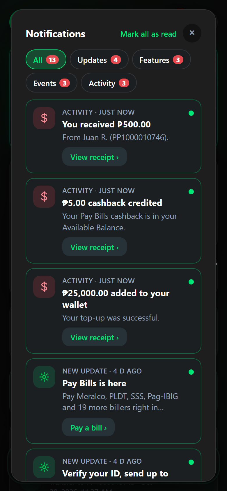 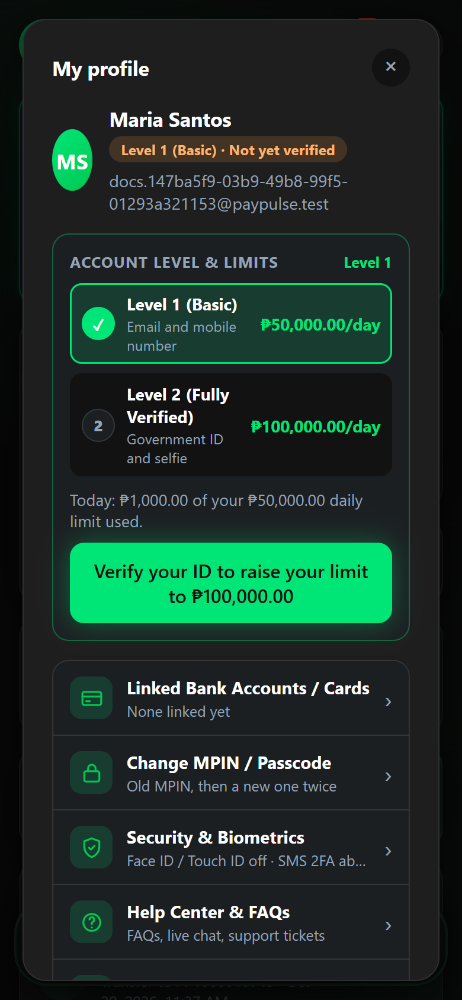 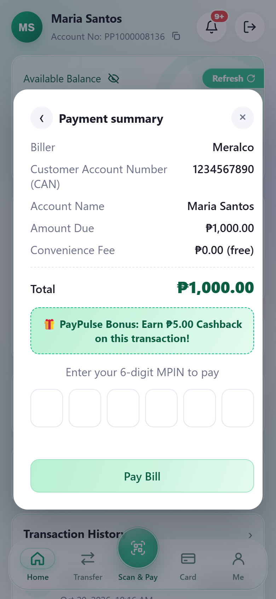 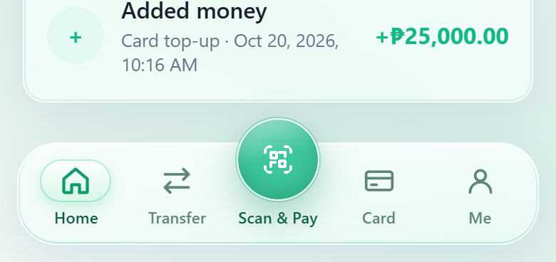

---

## Architecture

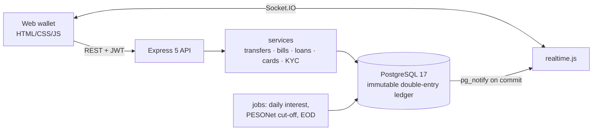

Balances are never stored: they are computed from an append-only ledger (`UPDATE`/`DELETE` are blocked by triggers),
mapped to a chart of accounts (GL 1010 cash … 5020 cashback expense).

### Tech stack

| Layer | Technology | Used for |
|-------|------------|----------|
| **Backend** | Node.js 24, Express 5 | REST API, middleware chain (auth, idempotency, chaos, AML, limits) |
| **Database** | PostgreSQL 17 with the `pg` driver | Double-entry ledger, explicit transactions and `SELECT … FOR UPDATE` row locks, advisory locks, triggers, `LISTEN/NOTIFY` |
| **Real-time** | Socket.IO 4 | JWT-authenticated, one room per user |
| **Security** | jsonwebtoken, bcryptjs, AES-256-GCM, HMAC | Sessions, MPIN / password hashing, card encryption, signed payment webhooks |
| **Frontend** | HTML, CSS, vanilla JavaScript | iOS glass UI, dark theme, mobile-first layout |
| **Test automation** | TypeScript, Playwright 1.64 | API tests, browser E2E, chaos / resilience, visual regression (`toHaveScreenshot`) |
| **Load / concurrency** | k6 1.3 | Race-condition and idempotency scenarios with HTML reports |
| **Infrastructure** | Docker Compose, GitHub Actions | Local stack; CI with a PostgreSQL service container and published reports |

---

## Quick start

**1. Start PayPulse with Docker** (app + PostgreSQL; the schema is applied automatically):

```bash
docker compose up --build              # or the older CLI: docker-compose up --build
# detached, waiting until healthy:  docker compose up -d --build --wait
```

Open **http://localhost:3000**, create an account (your MPIN is shown once) and try Send, Pay Bills
or Instant Loan. To use Add money and the QA Sandbox, make your account an admin:
`docker compose exec app node scripts/set-role.js you@example.com ADMIN`.

**2. Run the tests** (against the running app):

```bash
npm ci
npx playwright install ffmpeg            # for test videos (tests use your installed Chrome)
npx playwright test                       # all 374: projects api, ui, visual, a11y (+ ledger check at the end)
npx playwright test --project=ui          # E2E + chaos in a real browser
npx playwright test --project=a11y        # axe-core WCAG 2.2 AA scans + keyboard checks
npx playwright show-report                # open the HTML report (each axe scan is attached as JSON)

docker compose run --rm k6                                         # k6 race condition (known bug)
docker compose run --rm k6 run /scripts/idempotent-transfer.js     # k6 idempotency
npm run db:check && node scripts/assert-ledger.js && npm run eod:reconcile
```

Without Docker, use a local PostgreSQL, `npm run db:init` and `npm start` (see the reference docs).
Visual baselines are per OS; after an intended UI change run `npx playwright test --project=visual --update-snapshots`.

---

## Repository map

```
src/            Express API: routes, services (ledger, transfers, bills, loans, cards, KYC…), realtime.js
public/         web wallet (vanilla JS, iOS glass design)
db/schema.sql   schema, chart of accounts, immutability + notify triggers (re-runnable migration)
tests/api/      324 API tests (24 suites)            tests/e2e/      customer journeys in Chrome
tests/visual/   visual regression + baselines         tests/load/     k6: race + idempotency (+ HTML reports)
tests/a11y/     axe-core accessibility + keyboard     src/docs/       OpenAPI 3 document (served at /api-docs)
tests/resilience.spec.ts  chaos tests                 scripts/        ledger assertion, EOD reconciliation, workers
```

## More documentation

- **[QA_NOTES.md](QA_NOTES.md):** the race condition: root cause, reproduction, fix.
- **Interactive API docs:** **`/api-docs`** on the running app (Swagger UI: Authorize with your JWT and *Try it out*), raw OpenAPI 3 at `/api-docs/openapi.json`. Live: https://paypulse-4cqi.onrender.com/api-docs
- **Postman:** import [`postman/PayPulse.postman_collection.json`](postman/PayPulse.postman_collection.json) and an environment ([live](postman/PayPulse-live.postman_environment.json) or [local](postman/PayPulse-local.postman_environment.json)), then run **0. Setup** or the whole collection. With an empty `email` Setup registers a new customer; on the live server fill in your ADMIN account's `email` / `password` so Setup can add play money. Tokens, a fresh MPIN, transaction ids and pacing for the anti-spam / AML rules are handled by the collection's scripts. Regenerate after an API change with `npm run postman:build`; `npm run postman:test` runs it with newman.
- **[docs/TECHNICAL_REFERENCE.md](docs/TECHNICAL_REFERENCE.md):** full API reference, business rules, error codes, chart of accounts, every feature in detail.

---

*Built by **Brylle Opada** as a QA automation portfolio project. All balances are play money; billers, banks and card network are mocks.*
